<p align="center">
  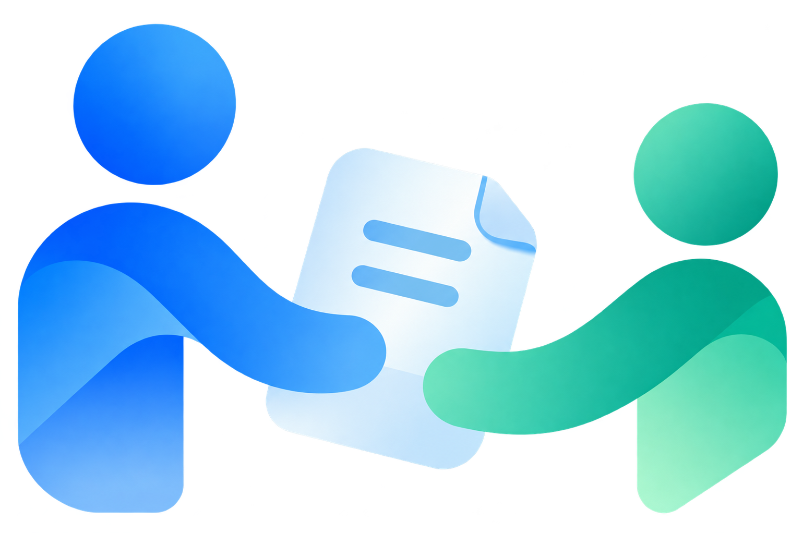
</p>

# Handovers

**People leave. Their context shouldn't.**

Someone resigns. Their notice period is 30 days. HR has to hire a replacement for a role they
don't fully understand, and make sure nothing the person did is lost. Usually the old job
description is three years out of date, the hiring manager is too busy to rewrite it, and the
knowledge transfer is a checkbox.

Handovers is a **company brain**. It keeps a memory of everyone's work in
[FalkorDB](https://www.falkordb.com/), learned from daily reports, tickets, pull requests, messages
and any document you upload. Leadership sees where the company would lose knowledge (Insights), every
employee can ask their own memory, and HR runs exits on top of it, from the resignation to the
relieving letter and the replacement hire. When someone resigns, it gives HR:

1. **A job description written from the person's actual work**, with a comparison against the old
   one: what it missed, and what it asked for that the job never used.
2. **A screening kit**: the bare minimum to check on a resume, and a checker that marks each
   criterion as meets, unclear or missing with a quote. No overall score, by design.
3. **An interview kit** a non-technical HR person can run: questions grounded in the real work,
   what good answers mention, and red flags.
4. **A handover plan ordered by what breaks first**: accounts only they administer, open work,
   recurring work only they do, relationships to introduce.
5. **An exit interview that asks only what nothing else explains.** The leaver reviews every
   answer before it's saved.
6. **A companion for the successor** that answers from the inherited memory, cites its sources,
   shows who approved the transfer, and says "I don't know" instead of guessing.

Around those, it keeps the handover on track and the next one cheaper:

- **"Ready by the last day?"**: six checks (successor, accounts, exit interview, job description,
  ramp-up plan, transfer), each with its owner and a one-click fix. Each person sees only the
  actions they can take.
- **Knowledge captured after approval is not lost**: late answers wait as "New since approval"
  until the manager sends them on as a follow-up transfer.
- **A first-month ramp-up plan** for the successor, built from the leaver's work, approved by the
  manager, with "Ask how" on each item.
- **Backups before anyone resigns**: managers see work only one teammate does and add a backup.
- **An exit pipeline with alerts**: Notice → Capture → Handover → Clearance → Exited. HR and the
  leaver's manager hear the moment someone resigns; reminders and approvals reach people in the
  app, by email, and on WhatsApp with buttons, within each person's quiet hours.
- **A handover document** written from the leaver's work, ordered by what breaks first, to print or
  save as a PDF with three sign-off lines (prepared by the leaver, reviewed by the manager, received
  by the successor).
- **Clearance and the relieving letter**: a no-dues checklist built from real access and work
  (accounts, work, assets, finance), each row with an owner. The letter is written for HR once every
  row is confirmed and the transfer is approved; it is emailed on the last day (company policy) or
  printed as a PDF. Nobody drafts it by hand.
- **Hiring when there is no backup**: a job description from the leaver's actual work (and what the
  old one missed), copy-ready fields for a job board (WorkIndia today), candidates imported from the
  board's export and screened per criterion, and an interview kit.
- **Insights** (leadership, HR): the north star (single-person knowledge resolved before the last
  day), backup coverage by team, what one person holds by kind, knowledge health (settings with no
  reason, fixes never written down, sources that disagree), the memory learned over time, who is
  joining and leaving, and the outcomes of completed handovers.
- **Policies** (HR): the withdrawal window, the questions every leaver answers, whether the letter
  waits for the last day, who counts as HR, IT and leadership, and the background jobs that run on
  their own (daily summary, last-day warnings, departures, letters).
- **Set up once by the platform admin**: one active directory (Microsoft Entra ID or Google
  Workspace, which also signs people in), work tools with several accounts each serving teams, and
  alert channels (WhatsApp, email) with a master switch each. Credentials are stored encrypted.
- **Graph X-ray** on every screen: the named Cypher queries FalkorDB ran, and the graph around it.
- **How it's built** (sidebar): the project's own architecture as a graph, stored in FalkorDB and
  read with one named query ([graph/project/](graph/project/README.md)).

Built for **[Graph Hacks: Context for AI Agents](https://www.wemakedevs.org/hackathons/falkordb)**
(WeMakeDevs × FalkorDB), **Track 03: Company Brain**.

| | |
|---|---|
| Live | https://handovers.omisaur.app (also https://34-100-187-124.sslip.io) |
| Demo video | *to be added* |

## Screenshots

| | |
|---|---|
| 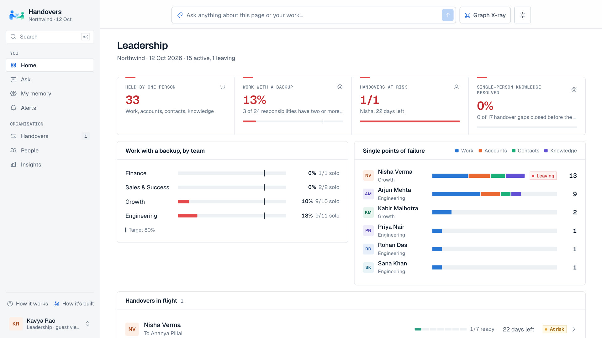 | 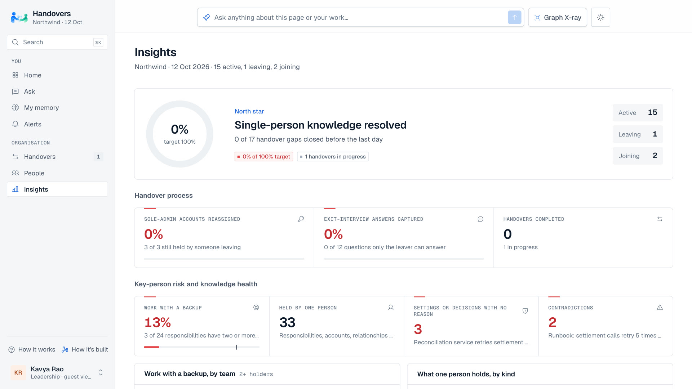 |
| **Leadership home**: what only one person holds, backup coverage by team, handovers in flight | **Insights**: north star, key-person risk, knowledge health, the memory over time, joiners and leavers |
| 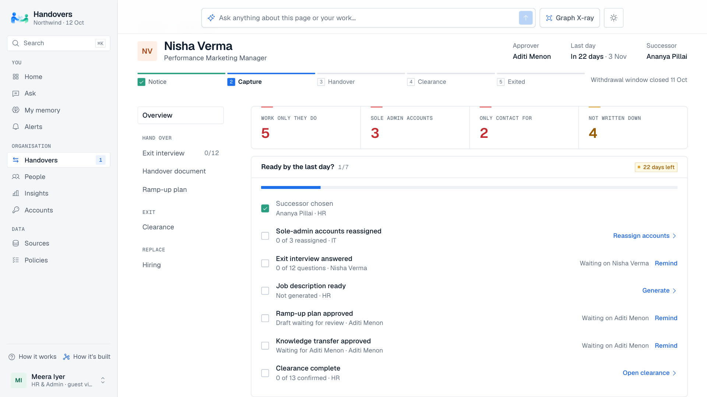 | 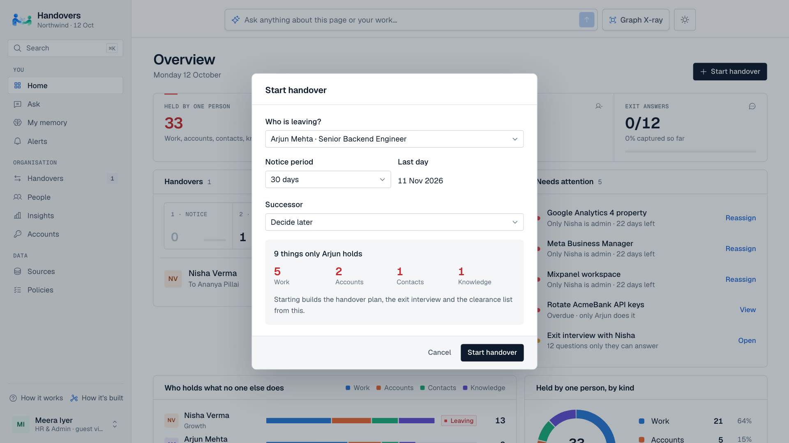 |
| **Ready by the last day?** (HR): the exit pipeline, each check with its owner and the next action | **Start a handover** in one dialog: what only this person holds, before anything starts |
| 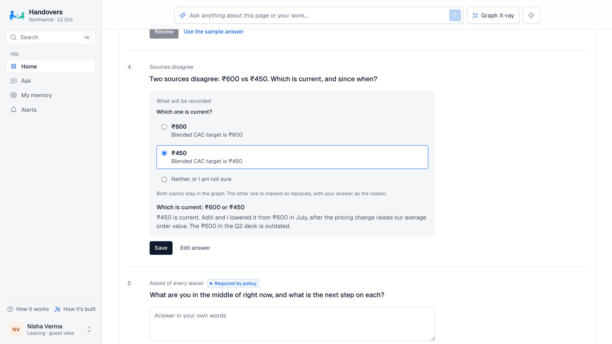 | 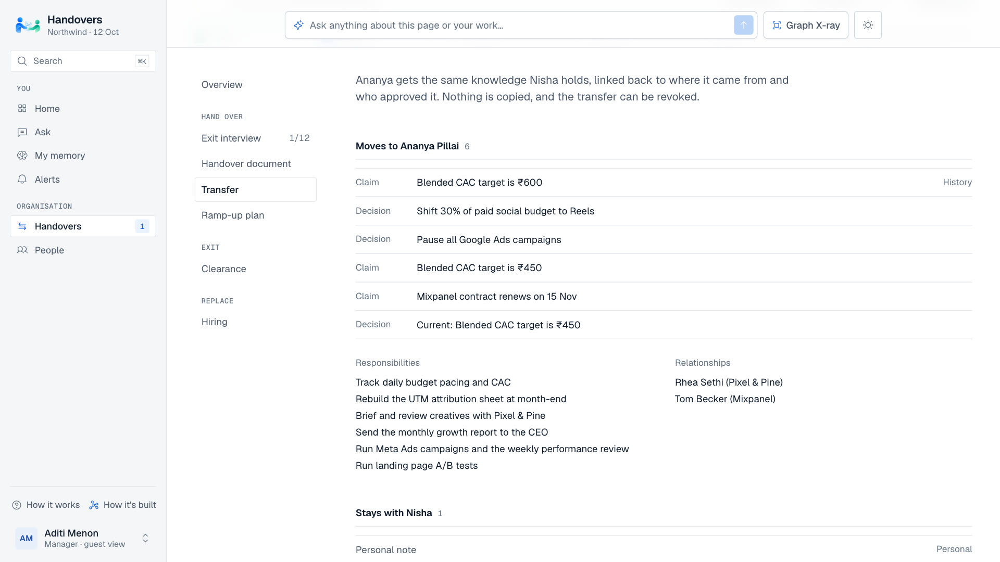 |
| **Exit interview** (leaver): two sources disagree; the leaver picks the current figure and sees what will be recorded | **Transfer review** (manager): what moves to the successor, what stays private, then approve |
| 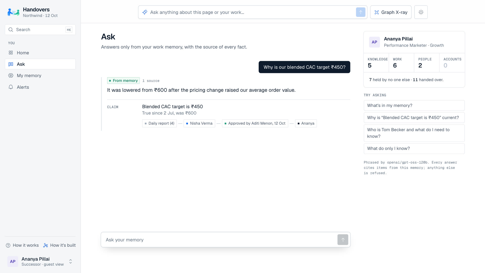 | 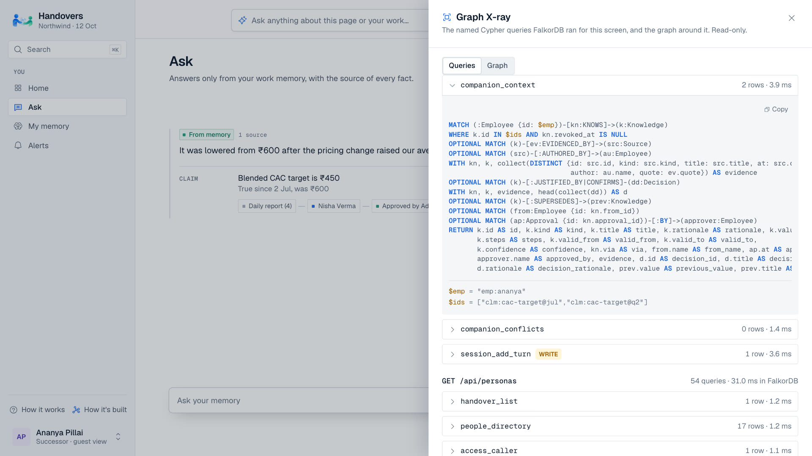 |
| **Successor's Ask**: Nisha's answer, with its source and "Approved by Aditi Menon" | **Graph X-ray**: the request, every named Cypher query FalkorDB ran, with its parameters |
| 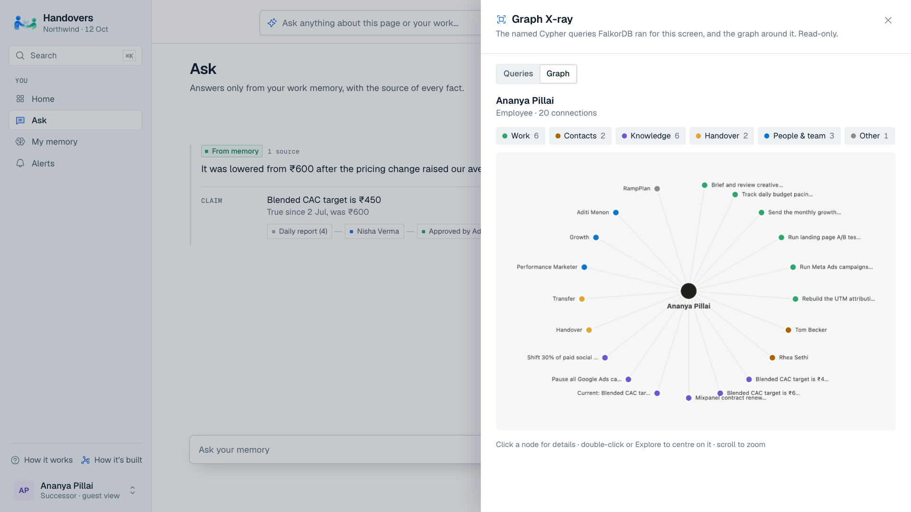 | 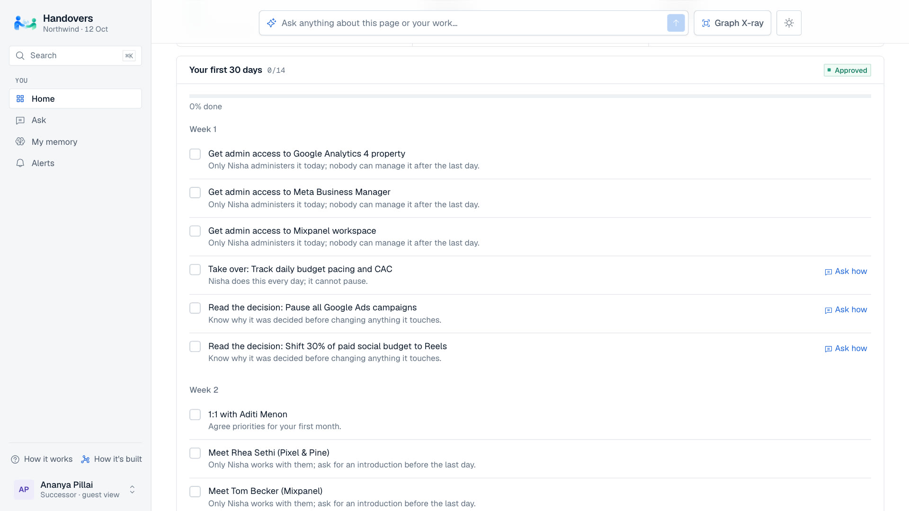 |
| **The graph around the successor** after the handover: work, contacts and knowledge | **Your first 30 days**: the approved ramp-up plan from the leaver's work, with "Ask how" |
| 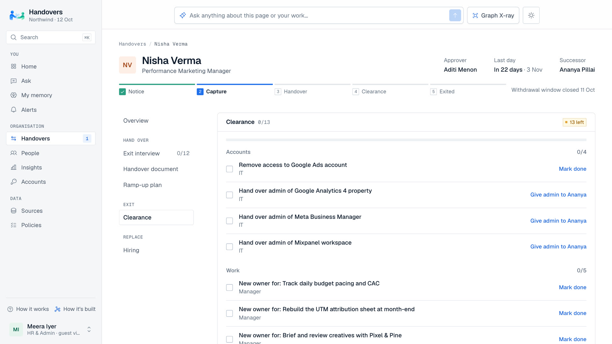 | 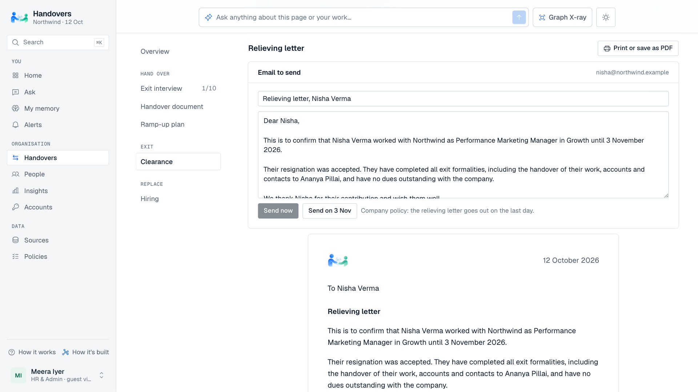 |
| **Clearance**: accounts, work, assets and finance, each row with an owner | **Relieving letter**: written once every row is confirmed; emailed on the last day or saved as a PDF |
| 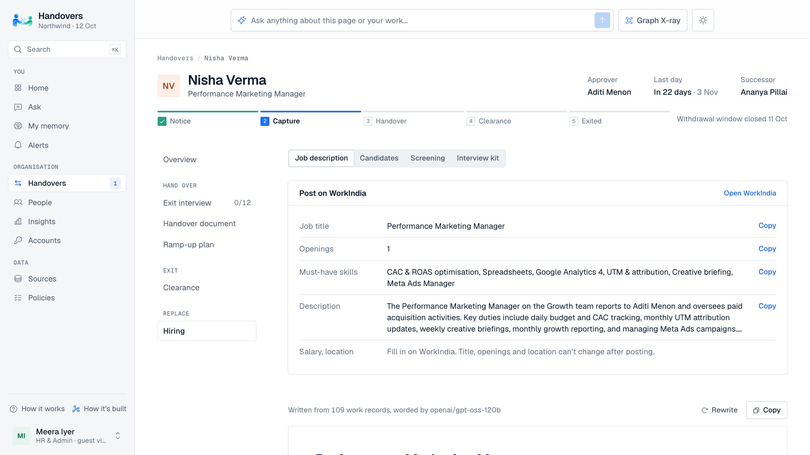 | 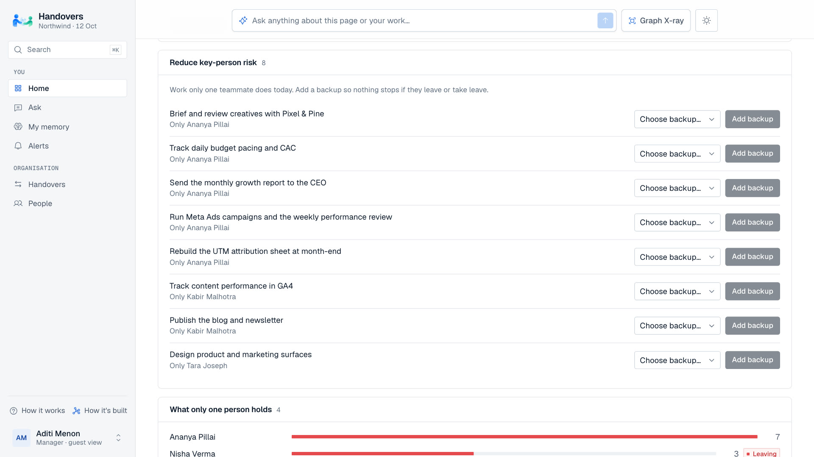 |
| **Hiring**: a job description from the real work, copy-ready for a job board, with screening and an interview kit | **Reduce key-person risk** (manager): after a handover the risk moves to the successor; add a backup |
| 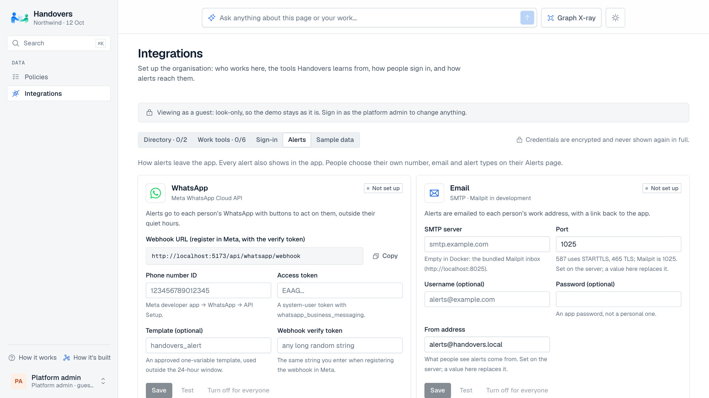 | 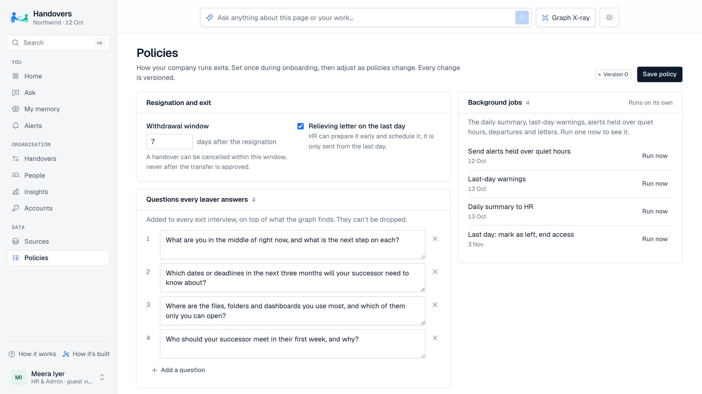 |
| **Alert channels** (platform admin): WhatsApp and email, each with settings, Test and a master switch | **Policies** (HR): exit rules, questions every leaver answers, background jobs, roles from the directory |
| 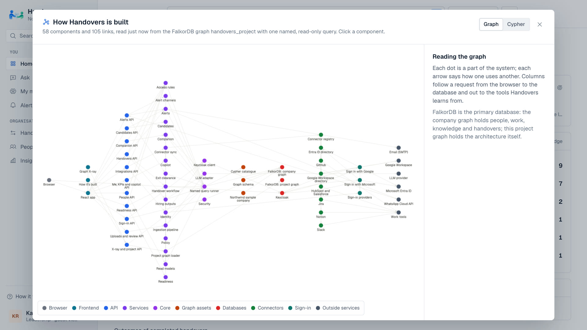 | |
| **How it's built**: the project's own architecture, stored in FalkorDB and read with one named query | |

---

## Why a graph

Every question Handovers answers is about sets, paths, absence or time. Vector search can answer
none of them.

| Question | What the graph does |
|---|---|
| What does only this person know or control? | Set difference over `KNOWS`, `RESPONSIBLE_FOR`, `HAS_ACCESS`, `WORKS_WITH` against every other active employee |
| What has no recorded reason? | A negative pattern: a current claim with no `JUSTIFIED_BY` path to a decision |
| What contradicts what? | Two live claims on the same subject and predicate whose validity overlaps, with no `SUPERSEDES` between them |
| What is true now, and what was true before? | Bi-temporal properties on every knowledge node plus the `SUPERSEDES` chain |
| What breaks first if they leave? | Accounts with exactly one admin; recurring work ordered by next due date |
| Where did the successor's answer come from? | The `KNOWS {via:'transfer'}` edge records who it came from and who approved it; `EVIDENCED_BY` leads to the source |

The successor's companion can only reach knowledge through the successor's own edges. Before the
transfer there is nothing to retrieve, so it abstains. That is enforced by the query, not a prompt.
Ask works the same for anyone's own memory: a targeted search first; for questions about the memory
as a whole ("what's in my memory?") or when the search misses, the LLM (Groq by default) reads a
compact list of that person's items and must cite them, and an answer citing nothing in the list is
refused.

## Graph data model

```
(:Employee)-[:MEMBER_OF]->(:Team)        (:Employee)-[:HAS_ROLE]->(:Role)<-[:DESCRIBES]-(:Source:Document)
(:Employee)-[:REPORTS_TO]->(:Employee)

(:Employee)-[:RESPONSIBLE_FOR {since, until, via}]->(:Responsibility)-[:NEEDS_SKILL]->(:Skill)
(:Employee)-[:HAS_ACCESS {role, since, until}]->(:Account)
(:Employee)-[:WORKS_WITH {context, touches}]->(:Stakeholder)
(:Employee)-[:KNOWS {via, private, from_id, approval_id}]->(:Knowledge:Decision|Procedure|Claim)

(:Knowledge)-[:EVIDENCED_BY {quote}]->(:Source:EOD|Ticket|PullRequest|Message|Meeting|Document|Upload|InterviewAnswer)
(:Knowledge)-[:JUSTIFIED_BY]->(:Decision)     (:Knowledge)-[:SUPERSEDES]->(:Knowledge)
(:Knowledge)-[:DOCUMENTED_IN]->(:Source)      (:Source)-[:AUTHORED_BY]->(:Employee)
(:Source)-[:SHOWS_SKILL]->(:Skill)            (:Responsibility|Account|Stakeholder)-[:EVIDENCED_BY]->(:Source)

(:Handover)-[:FOR]->(:Employee)  (:Handover)-[:SUCCESSOR]->(:Employee)  (:Handover)-[:HAS_GAP]->(:Gap)
(:Handover)-[:HAS_TRANSFER]->(:Transfer)-[:APPROVED_IN]->(:Approval)-[:BY]->(:Employee)
(:Transfer)-[:INCLUDED|EXCLUDED {reason}]->(:Knowledge|Responsibility|Stakeholder)
```

- **Three layers.** Sources are immutable evidence. Knowledge is shared and bi-temporal
  (`valid_from`, `valid_to`, `recorded_at`, `retracted_at`, in epoch ms; open intervals use
  `253402300799000`). Who holds what is a set of edges.
- **Nothing is overwritten.** A change is a new node plus `SUPERSEDES`.
- **Transfers copy nothing.** The successor gets new `KNOWS` edges to the *same* knowledge nodes,
  with lineage on the edge, so a later correction reaches everyone at once.
- **One graph per tenant** (`handovers__<tenant>`); FalkorDB keeps graphs isolated.
- **Confidence** is a noisy-OR over distinct evidence (`1 − Π(1 − quality)`), recomputed in one query.

## Cypher queries

Every query the product runs is a parameterised file in [`graph/queries/`](graph/queries/), loaded
by name. The app never builds Cypher from user input. `GET /api/queries` lists them all. The most
important ones:

| Query | Purpose |
|---|---|
| [`risk_sole_*`](graph/queries/) | Per person: responsibilities, admin accounts, relationships and knowledge nobody else holds |
| [`gap_g1_claims`](graph/queries/gap_g1_claims.cypher), [`gap_g1_decisions`](graph/queries/gap_g1_decisions.cypher) | A current setting or decision only the leaver holds, with no recorded reason |
| [`gap_g6_contradictions`](graph/queries/gap_g6_contradictions.cypher) | Sources that disagree about the same thing |
| [`gap_g7_accounts`](graph/queries/gap_g7_accounts.cypher), [`gap_g7_stakeholders`](graph/queries/gap_g7_stakeholders.cypher) | Sole admin, sole external contact |
| [`gap_g8_recurring_fix`](graph/queries/gap_g8_recurring_fix.cypher) | A fix handled repeatedly with no procedure written down |
| [`person_responsibilities`](graph/queries/person_responsibilities.cypher) | What someone does, ranked by the share of their logged work that evidences it |
| [`role_old_jd`](graph/queries/role_old_jd.cypher) | The last uploaded job description for the role, for the comparison |
| [`transfer_apply_knowledge`](graph/queries/transfer_apply_knowledge.cypher) | Successor gains `KNOWS` edges with lineage, only through an approved transfer |
| [`companion_search`](graph/queries/companion_search.cypher), [`companion_context`](graph/queries/companion_context.cypher) | Full-text candidates anchored at the asker's own edges, then evidence, the decision behind it and what it replaced |
| [`knowledge_confidence`](graph/queries/knowledge_confidence.cypher) | Noisy-OR confidence over distinct evidence |
| [`dash_team_coverage`](graph/queries/dash_team_coverage.cypher) | Per team: current responsibilities and how many have only one active owner (the Overview's coverage chart) |
| [`kpi_handover_outcomes`](graph/queries/kpi_handover_outcomes.cypher) | Completed handovers: first transfer applied vs the last day, and knowledge included in approved transfers (the outcome KPIs) |
| [`dash_activity`](graph/queries/dash_activity.cypher) | Work records by day, for the memory heatmap |
| [`clearance_resolved`](graph/queries/clearance_resolved.cypher) | Clearance rows the graph already settles: someone else now holds the leaver's admin account or owns their work |
| [`alert_add`](graph/queries/alert_add.cypher), [`alert_last_reminder`](graph/queries/alert_last_reminder.cypher) | Every alert (WhatsApp or in-app) is an `Alert` node linked to its handover and recipient; the last reminder per readiness step |

Example: G1, the "why is it set this way?" detector.

```cypher
MATCH (e:Employee {id: $emp})-[:KNOWS]->(c:Claim)
WHERE c.valid_to > $now AND c.retracted_at > $now AND c.sensitivity <> 'personal'
  AND c.predicate IN $predicates AND NOT (c)-[:JUSTIFIED_BY]->(:Decision)
OPTIONAL MATCH (o:Employee {status: 'active'})-[:KNOWS]->(c)
WHERE o.id <> $emp
WITH c, count(o) AS others
WHERE others = 0
OPTIONAL MATCH (c)-[:SUPERSEDES]->(prev:Claim)
RETURN c.id AS target, c.title AS title, c.value AS value, prev.value AS previous
```

## How it works

```
Upload anything / connectors / daily reports
   → parse (MarkItDown for prose, pandas templates for spreadsheets)
   → extract into a closed schema (Gemini structured output, or rules without an LLM)
   → resolve names and titles to known ids → low confidence waits in a review queue
   → typed, parameterised MERGE into FalkorDB

Resignation → graph analysis (sole holders, gap rules) → HR outputs
   → exit interview (only the gaps; leaver confirms each answer)
   → manager approves the transfer → successor companion
```

The first screen is an Overview that answers one question: where is the company about to lose
knowledge, and is it being handed over in time? It shows things that need attention, every active handover
with its health, who holds the most work that no one else does (click a person to see what would go
if they left), backup coverage by team, and the knowledge-health checks. Every number comes from the
graph queries above (`GET /api/dashboard`, `GET /api/people/{id}/simulate`).

The LLM extracts structure and words prose. It never decides what is at risk, what transfers or
who knows what; graph queries do. Every LLM call has a deterministic fallback, so the product runs
with `LLM_PROVIDER=none`.

| Layer | Choice |
|---|---|
| Graph | FalkorDB 6.0.1 (Docker and live); the only stateful store |
| Backend | Python 3.12, FastAPI, `falkordb` async client |
| LLM | Optional: Groq (`openai/gpt-oss-120b`), Gemini 2.5 Flash on Vertex AI or Claude; temperature 0. `LLM_PROVIDER=none` runs on templates |
| Parsing | MarkItDown, pandas/openpyxl |
| Frontend | React 19, React Router 7, Vite, Tailwind CSS 4 |
| Deploy | Docker Compose on one Compute Engine VM behind Caddy |

## Results

`python -m bench.run`: 18 questions a successor would ask, 2 of them traps about private notes.
Retrieval only (no LLM), on a freshly seeded graph, against **FalkorDB 6.0.1** (the version that runs
live). Full output, including every retrieved id:
[`graph/benchmark/results/`](graph/benchmark/results/).

| Setup | Right source in top 4 | Right source first | Private notes leaked |
|---|---|---|---|
| Successor before the handover | 0% | 0% | 0 |
| **Successor after the handover** | **100%** | **100%** | **0** |
| Full-text search over every document | 56% | 19% | 1 |
| Copy all of the leaver's memory, no review | 69% | 50% | 1 |

Reproduce it: start FalkorDB (`docker compose up -d falkordb`), then `cd app/backend && uv run
python -m bench.run`. It runs in about two seconds on its own tenant graph and writes a new file to
`graph/benchmark/results/`; the 17 Oct 2026 run (`2026-10-17-falkordb-60001.json`) gives the same
numbers as the table.

Why the handover wins on "first": it knows what is current. When the deck says one CAC target and
the daily reports say another, the exit interview resolves it and the stale claim is superseded.
Document search returns whichever text matches best, including a private 1:1 note.

## Setup

**Prerequisites:** Docker Desktop (Compose v2), git and Python 3.10+. To work on the code outside
Docker, also [uv](https://docs.astral.sh/uv/) and Node.js 22.12+.

### 1. Two commands

```bash
python setup.py            # checks your machine, asks two questions, writes .env with fresh secrets
docker compose up -d --build
```

The same in PowerShell. `setup.py` asks for an optional Groq API key (the AI features; the app runs
on templates without one) and whether to run Keycloak sign-in, finds free ports, and prints the next
steps, including the demo sign-in password. Then open http://localhost:5173: sign in with a Northwind
email (Continue with email) or explore as a guest. The sample company loads into an empty graph on
first start. FalkorDB Browser: http://localhost:3000 (password: `FALKORDB_PASSWORD` in `.env`).
Alert emails land in Mailpit, a local inbox: http://localhost:8025.

After pulling a change to `.env.example`, run `python setup.py --update`: it adds the new keys and
keeps your values. `--force` starts over (keeps `.env.bak` and the secrets your data depends on);
`--print` shows the result without writing.

**Google and Microsoft sign-in, connectors:** in the app, **Integrations** (as Meera, HR). Each
connector has **Test connection**; tokens are stored encrypted. Details:
[docs/identity-and-access.md](docs/identity-and-access.md) §0, [docs/connectors.md](docs/connectors.md).

### 2. Working on the code (live reload)

Keep FalkorDB (and Keycloak) in Docker; run the backend and frontend on your machine.

```bash
# bash
docker compose stop backend frontend
cd app/backend && uv sync && uv run uvicorn main:app --reload
# second terminal
cd app/frontend && npm install && npm run dev
```
```powershell
# PowerShell
docker compose stop backend frontend
cd app\backend; uv sync; uv run uvicorn main:app --reload
# second terminal
cd app\frontend; npm install; npm run dev
```

Back to everything in Docker: `docker compose up -d --build backend frontend`.

### 3. Tests and benchmark

```bash
cd app/backend
uv run pytest            # unit + integration (needs FalkorDB)
uv run python -m bench.run
```

## Repository map

| Path | Purpose |
|---|---|
| [app/backend/](app/backend/README.md) | FastAPI app: `api/`, `services/` (analysis, generators, handover, companion), `ingestion/`, `seed/`, `bench/` |
| [app/frontend/](app/frontend/README.md) | React UI |
| [graph/](graph/README.md) | Schema, named Cypher queries, sample company, benchmark results |
| [deployment/](deployment/README.md) | Live deployment (Compute Engine + Caddy) |
| [docs/](docs/README.md) | Design notes |
| [AGENTS.md](AGENTS.md) | Contributor rules |

## Data and privacy

All people, companies and events are synthetic. Handovers records work facts (duties, accounts,
relationships, decisions, procedures), never performance, health, salary or personal life.
Personal notes are never shown to others and never transfer. Employees can mark any item private.
Screening outputs criteria and evidence, never a candidate score.

## Submission checklist

- [ ] Public repository with this README (setup + graph data model)
- [x] Cypher queries used ([`graph/queries/`](graph/queries/))
- [ ] Demo video
- [x] Live deployment and local setup instructions
- [x] Track selected: Track 03, Company Brain
- [x] AI-assistance disclosure (below)

## AI assistance disclosure

- **Building it:** Claude Code (Anthropic) was used for research, design, implementation, tests
  and documentation, working with the team, who reviewed and own every decision and can explain the
  graph model, queries and architecture.
- **Running it:** an optional LLM (Groq `openai/gpt-oss-120b`, Gemini 2.5 Flash on Vertex AI or
  Claude) extracts structured facts from uploads and interview answers, and words the job
  description, interview kit, companion answers and the in-app copilot. It never decides what is at
  risk, what transfers or who knows what; graph queries do.
- **The demo video:** recorded from the running app with a scripted browser (Playwright). The
  narration is ElevenLabs text-to-speech (voice "Raj") reading a script the team approved; sound
  effects and background music are ElevenLabs-generated.

## License

[MIT](LICENSE)
